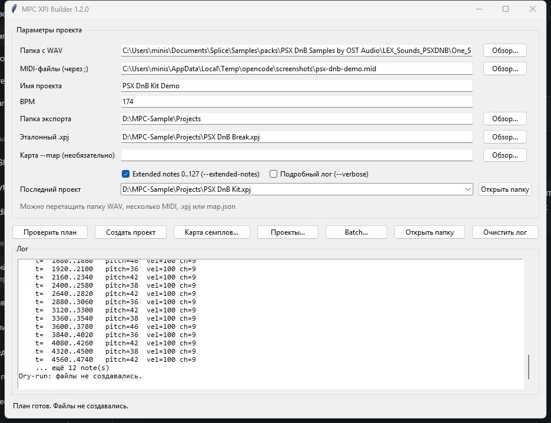
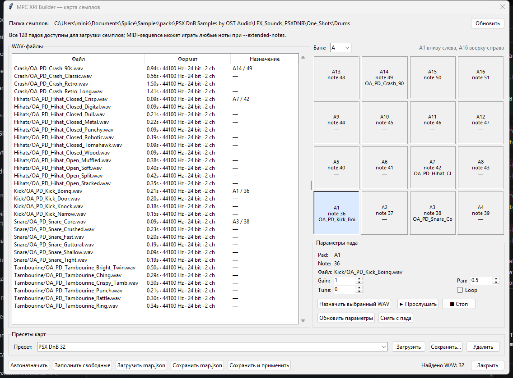
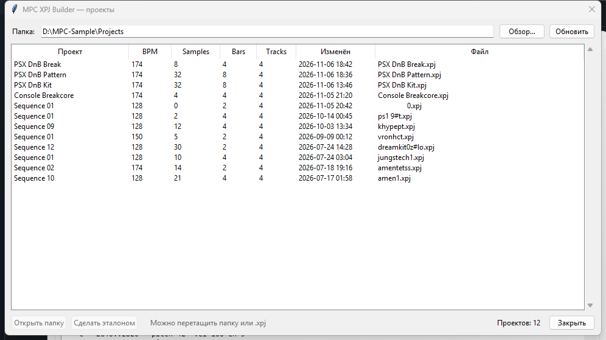
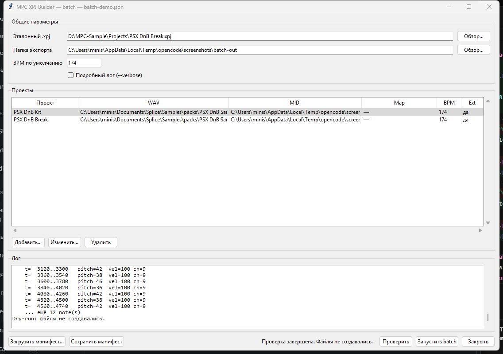

# mpc-xpj-builder

[](https://github.com/cursednik/mpc-xpj-builder/actions/workflows/ci.yml)

**v1.2.0** — сборка drum-проекта для **Akai MPC Sample** из папки WAV и одного
Standard MIDI File. Windows GUI, CLI и batch-режим.

[Скачать](https://github.com/cursednik/mpc-xpj-builder/releases) ·
[Руководство пользователя](docs/USER_GUIDE.md)



## Возможности

- GUI и CLI для Windows, без runtime-зависимостей.
- Pad-based карта на все 128 падов, банки A–H.
- Редактор карты с автоназначением и `map.json`.
- Прослушивание WAV прямо в редакторе карты.
- Extended MIDI notes 0–127.
- Несколько MIDI-файлов превращаются в несколько MPC sequence.
- Loop, gain, pan, tune.
- Batch-сборка нескольких проектов из JSON-манифеста.
- Браузер проектов и recent projects.
- Drag-and-drop WAV, MIDI, `.xpj` и `map.json` из проводника.
- Windows installer и portable ZIP.

## Документация

- [Руководство пользователя](docs/USER_GUIDE.md) — установка, GUI, карта,
  браузер, batch, troubleshooting.
- [Проверка на железе](docs/HARDWARE_TEST.md) — чек-лист для MPC Sample.
- [История валидации](docs/VALIDATION.md) — что и на какой прошивке проверено.

## Важное ограничение

Формат `.xpj` закрытый. Без эталонного проекта нельзя гарантировать, что
синтезированный JSON откроется на конкретной прошивке. Поэтому инструмент:

- **читает** эталонный `.xpj` через `--inspect`;
- **клонирует** эталонный `.xpj` при экспорте (`--template`) и меняет только
  документированные поля: имя, BPM, samples, pad-назначения, sequence и notes;
- **не придумывает** неизвестные поля;
- **блокирует** реальный экспорт без `--template` с сообщением
  «Требуется эталонный .xpj от MPC Sample для заполнения схемы»;
- позволяет посмотреть план и ограничения через `--dry-run` даже без эталона.

Итоговая папка ресурсов: `<ProjectName>_[ProjectData]` — именно такой вариант
используют известные реализации для MPC Sample / MPC 3.x.

## Зависимости

Только стандартная библиотека Python 3.11+. Runtime-зависимостей нет.

## Установка как CLI

```powershell
python -m venv .venv
.\.venv\Scripts\Activate.ps1
python -m pip install -e .
mpc-xpj-builder --version
mpc-xpj-builder --help
```

После установки доступна команда `mpc-xpj-builder` с теми же аргументами,
что и `python main.py`.

## GUI

После установки:

```powershell
mpc-xpj-builder-gui
```

Или из исходников:

```powershell
python gui.py
```

GUI позволяет выбрать папку семплов, MIDI, эталонный `.xpj`, карту `--map`,
имя/BPM/папку экспорта, посмотреть план (`--dry-run`) или создать проект.
Сборка идёт в фоне, лог показывается в окне.

Кнопка **«Карта семплов…»** открывает редактор:



- список WAV с длительностью/форматом;
- сетка всех 128 pads по банкам A–H (A1 внизу слева, как на MPC Sample);
- назначение выбранного WAV на pad;
- `gain`, `pan`, `tune`, `loop`;
- автоназначение по числовому префиксу (`36_kick.wav`) и именам
  (`kick`, `snare`, `hat`, `ride`, `crash`, …);
- загрузка/сохранение `map.json`;
- прослушивание WAV: выбранного в списке или назначенного на пад
  (`▶ Прослушать` / `■ Стоп`);
- именованные пресеты карт: сохранить, загрузить, удалить;
- «Сохранить и применить» подставляет путь в поле `--map`.

GUI сохраняет последние папки, MIDI, template, map, имя, BPM и флаги в:

```text
%APPDATA%\mpc-xpj-builder\settings.json
```

При следующем запуске поля заполняются автоматически. GUI также хранит до 10
последних созданных проектов; выбранный проект можно открыть в проводнике.

Кнопка **«Проекты…»** открывает browser всех `.xpj` в папке экспорта:



В таблице показаны имя, BPM, число семплов, такты, число треков, дата изменения.
Оттуда можно открыть папку проекта или назначить проект эталоном. В окно
браузера можно перетащить папку с проектами или `.xpj`: папка откроется, а
перетащенный проект будет выбран в таблице.

Кнопка **«Batch…»** открывает окно batch-сборки:



В окне: общие `template`, `output` и BPM, таблица проектов,
добавление/изменение/удаление job, `map` и `extended_notes`, проверка
(`--dry-run`) и запуск всего batch. Манифест можно загрузить из `.json` и
сохранить обратно.

В главное окно можно перетащить:

- папку с WAV — подставится в `--samples`;
- `.wav` — подставится его папка;
- `.mid` / `.midi` — MIDI;
- `.xpj` — эталон;
- `.json` — карта `--map`.

## Сборка `.exe`

PyInstaller нужен только для сборки, не для работы:

```powershell
python -m pip install -e ".[dev]"
powershell -ExecutionPolicy Bypass -File .\scripts\build_exe.ps1 -Clean
powershell -ExecutionPolicy Bypass -File .\scripts\build_gui_exe.ps1 -Clean
powershell -ExecutionPolicy Bypass -File .\scripts\build_portable.ps1
```

Результаты:

```text
dist\mpc-xpj-builder.exe
dist\mpc-xpj-builder-gui.exe
dist\mpc-xpj-builder-v1.2.0-win64.zip
```

Windows installer (нужен Inno Setup 6):

```powershell
powershell -ExecutionPolicy Bypass -File .\scripts\build_installer.ps1
```

Результат:

```text
dist\mpc-xpj-builder-v1.2.0-setup.exe
```

## Как получить эталон

На MPC Sample создайте минимальный drum-проект (один drum-трек, одна sequence),
сохраните его и скопируйте полученный `.xpj` на компьютер. Этот файл должен быть
создан **той же прошивкой**, на которой потом будет открываться результат.

## Команды

Проверка эталона (исходный файл не изменяется):

```powershell
python main.py --inspect reference.xpj
```

После этого рядом появится `reference_pretty.json`.

План без создания файлов (можно запускать до получения эталона):

```powershell
python main.py `
  --samples "C:\Samples\Kit" `
  --midi "C:\MIDI\drums.mid" `
  --name "My Kit" `
  --bpm 120 `
  --output "C:\MPC Projects" `
  --dry-run --verbose
```

Реальный экспорт:

```powershell
python main.py `
  --samples "C:\Samples\Kit" `
  --midi "C:\MIDI\drums.mid" `
  --name "My Kit" `
  --bpm 120 `
  --output "C:\MPC Projects" `
  --template "C:\MPC Projects\reference.xpj" `
  --verbose
```

Несколько `--midi` создают несколько sequence в одном проекте:

```powershell
python main.py `
  --samples "C:\Samples\Kit" `
  --midi "C:\MIDI\verse.mid" `
  --midi "C:\MIDI\chorus.mid" `
  --name "My Kit" `
  --bpm 174 `
  --output "C:\MPC Projects" `
  --template "C:\MPC Projects\reference.xpj" `
  --verbose
```

Файлы также можно перечислить одной строкой через `;`.

Экспорт с явной картой семплов:

```powershell
python main.py `
  --samples "C:\Samples\Kit" `
  --midi "C:\MIDI\drums.mid" `
  --name "My Kit" `
  --bpm 174 `
  --output "C:\MPC Projects" `
  --template "C:\MPC Projects\reference.xpj" `
  --map "C:\MPC Projects\my-kit-map.json" `
  --verbose
```

Если карта использует банки B–H и MIDI-ноты за пределами 35–51:

```powershell
python main.py `
  --samples "C:\Samples\Kit" `
  --midi "C:\MIDI\drums.mid" `
  --name "My Kit" `
  --bpm 174 `
  --output "C:\MPC Projects" `
  --template "C:\MPC Projects\reference.xpj" `
  --map "C:\MPC Projects\my-kit-map.json" `
  --extended-notes `
  --verbose
```

Результат:

```text
My Kit.xpj
My Kit_[ProjectData]\
    Kick_01.wav
    Snare_01.wav
    ...
```

## Карта семплов `--map`

Пример лежит в `examples/map.example.json`. Рекомендуемый формат:

```json
{
  "samples": [
    {
      "file": "kicks/kick.wav",
      "note": 36,
      "gain": 0.9,
      "pan": 0.5,
      "tune": 0.0,
      "loop": false
    },
    {
      "file": "snares/snare.wav",
      "note": 38,
      "gain": 1.0,
      "pan": 0.5
    },
    {
      "file": "cymbals/ride.wav",
      "pad": "B1",
      "gain": 0.8
    }
  ]
}
```

Допустим и компактный формат:

```json
{
  "kick":  { "file": "kick.wav", "note": 36 },
  "snare": { "file": "snare.wav", "note": 38 }
}
```

Правила:

- `file` — путь относительно папки `--samples`; `..` и абсолютные пути запрещены;
- `note` — MIDI-нота; по умолчанию `35..51`, с `--extended-notes` — `0..127`;
- `pad` — `A1..H16`, можно использовать вместо `note` для любого из 128 падов;
- `gain` — `0..1`;
- `pan` — `0..1`;
- `tune` — полутона, `-24..24` (дробные значения раскладываются в coarse/fine);
- `loop` — `bool`;
- один и тот же WAV можно назначить на несколько падов;
- WAV, не упомянутые в карте, игнорируются;
- дубли `note`/`pad` запрещены.

## Правила назначения

- По умолчанию поддерживаются MIDI-ноты **35..51**.
- `--extended-notes` разрешает MIDI-ноты **0..127** (все банки A–H).
- Максимум **128** WAV-файлов.
- WAV: RIFF/WAVE, PCM или IEEE float, mono/stereo, 8/16/24/32-bit PCM или
  32-bit float, 8–192 kHz.
- WAV-имена приводятся к ASCII `[A-Za-z0-9_]`, без пробелов; при конфликте
  добавляется `_01`, `_02`, ...
- Без `--map` семплы сортируются по относительному пути; уникальные ноты — по
  возрастанию. Первые N семплов назначаются N уникальным нотам, остальные —
  свободным падам.
- С `--map` используются только файлы из карты; лишние WAV игнорируются.
- Карта `pad <-> MIDI note` берётся из `padNoteMap` эталонного проекта.
  Для dry-run без эталона используется наблюдаемая карта MPC Sample:
  A1–A16 = 36–51, B1 = 52, …, H16 = 35.
- Каждый MIDI-файл превращается в отдельную MPC sequence; `trackClipMaps`
  каждой sequence содержит одну строку с клипами всех сохранённых треков.
  Инфраструктурные треки (submix/output) из эталона сохраняются.

## Batch-режим `--batch`

Один JSON-манифест — несколько проектов. Пример: `examples/batch.example.json`.

```json
{
  "template": "D:\\MPC-Sample\\Projects\\reference.xpj",
  "output": "D:\\MPC-Sample\\Projects",
  "bpm": 174,
  "jobs": [
    {
      "name": "Kit A",
      "samples": "C:\\Samples\\Kit A",
      "midi": "C:\\MIDI\\kit-a.mid",
      "map": "C:\\Samples\\Kit A\\map.json"
    },
    {
      "name": "Kit B",
      "samples": "C:\\Samples\\Kit B",
      "midi": "C:\\MIDI\\kit-b.mid",
      "bpm": 160
    }
  ]
}
```

Запуск:

```powershell
python main.py --batch "C:\MPC Projects\batch.json" --dry-run
python main.py --batch "C:\MPC Projects\batch.json" --verbose
```

Правила:

- относительные пути в манифесте считаются от папки манифеста;
- `template`, `output`, `bpm` можно задать глобально и переопределить в job;
- `map` и `extended_notes` задаются на уровне job;
- все job сначала проходят preflight;
- при ошибке preflight **ни один** проект не записывается;
- при ошибке записи уже созданные проекты не откатываются;
- дубли имён/целей запрещены.

## Коды возврата

| Код | Значение |
| ---: | --- |
| 0 | успех / dry-run |
| 2 | ошибка аргументов CLI |
| 3 | ошибка валидации входных данных |
| 4 | схема требует эталонный `.xpj` |
| 5 | ошибка файловой системы / записи |
| 1 | непредвиденная ошибка |

## Известные неизвестные

Список ведётся в `xpj_schema.py` (`unresolved_fields()`):

- версия и platform в заголовке;
- top-level UI/controller/mixer-поля (`data.*`);
- `programPads`, `base.*`, custom Q-Link и macro-scene поля;
- полная структура `drum.instruments[]` (synthSection, articulations,
  chopProperties, padEffects, modLinks, noteCounters, random seeds);
- `padNoteMap` и семантика pad index на конкретной прошивке;
- `loadImpl` и metadata семплов;
- служебные поля sequence/clip/event;
- `data.mixer`;
- версии схемы и точное имя ProjectData-папки.

Всё перечисленное сохраняется из `--template`, а не синтезируется.

## Калибровка по эталону 1.3.0.12

Проверено на реальном пустом проекте MPC Sample:

- `trackClipMaps` — ровно **одна строка**, внутри неё по одному клипу на каждый
  трек (`Drum`, `Out 1/2`, `Out 3/4`, `Submix 1`);
- у слоя `sampleEnd = 0`, а длина задаётся `sliceInfo.End = frames - 1`;
- `sliceIndex = 129`;
- `sampleName` и `sampleFile` — без расширения в имени семпла;
- `loadImpl` встречается как `0`, так и `1`;
- порядок клипов в строке сохраняется из эталона.

Loop-калибровка по пересохранённому MPC Sample проекту:

- loop включается через `instrument.triggerMode = 3`;
- `layer.loop` остаётся `false`;
- `layer.loopMode = 1`;
- `layer.layerLoopModeOverridesSliceLoopMode = true`;
- `sliceInfo.LoopMode = 1`;
- `sliceInfo.LoopCrossfadeLength = -1`.

## Hardware test kit

Сгенерировать набор проектов для ручной проверки на MPC Sample:

```powershell
python scripts/make_hardware_test_kit.py `
  --template "D:\MPC-Sample\Projects\                0.xpj" `
  --output "D:\MPC-Sample\Projects\XPJ Hardware Test"
```

Создаются:

- `XPJ Test Notes` — 17 нот 35..51;
- `XPJ Test Loop` — loop-семпл;
- `XPJ Test Long` — длинный one-shot;
- `XPJ Test 128` — 128 WAV;
- `README-HARDWARE-TEST.md` — чек-лист.

Подробности: `docs/HARDWARE_TEST.md`.

## Тесты

```powershell
python -m unittest discover -s tests -v
```

Покрыты: карта `--map`, конфликты/ошибки карты, batch-манифест и preflight,
running status и note-on velocity 0 в MIDI, tempo/time signature, dry-run,
экспорт с mapped-семплами, `sampleEnd`, `sliceInfo.End`, gain/pan/tune/loop,
GUI-аргументы, project browser, drag-and-drop routing, pad-based карта,
extended-ноты, автоназначение, настройки GUI, recent projects, native drag-and-drop,
пресеты карт, batch GUI, несколько sequence, прослушивание WAV и игнорирование
лишних WAV. Всего 76 тестов.

## Статус проверки

Код компилируется и проверен на синтетических WAV/MIDI, реальном эталонном
`.xpj` и реальных семплах (чтение, dry-run, экспорт, повторный `--inspect`).

**Hardware:** `PSX DnB Kit` успешно открыт на MPC Sample, все 32 one-shot
семпла загрузились. Это подтвердило pad-based mapping и загрузку банка B.
`XPJ Test Long` и `XPJ Test 128` также прошли проверку. Loop-фикс подтверждён
проектом `XPJ Loop Final`: loop играет сразу после загрузки, без ручного
переключения. Музыкальный `PSX DnB Break` на 8 падов также подтверждён.

Несколько sequence в одном проекте пока проверены структурно и через
`--inspect`; на самом MPC Sample эта комбинация ещё не тестировалась.

## Источники наблюдений

- `kurtjcu/MPC-project-file-definitions` — публичная база полей MPC 3.x `.xpj`.
- `tarikcampos/MPC-Sample-Toolkit` и `WorldLinkStudio/mpcsample` — открытые
  реализации, подтверждавшие загрузку проектов на MPC Sample.
- Локальный эталонный `.xpj` целевой прошивки — единственный источник истины
  для полей, помеченных как неизвестные.

