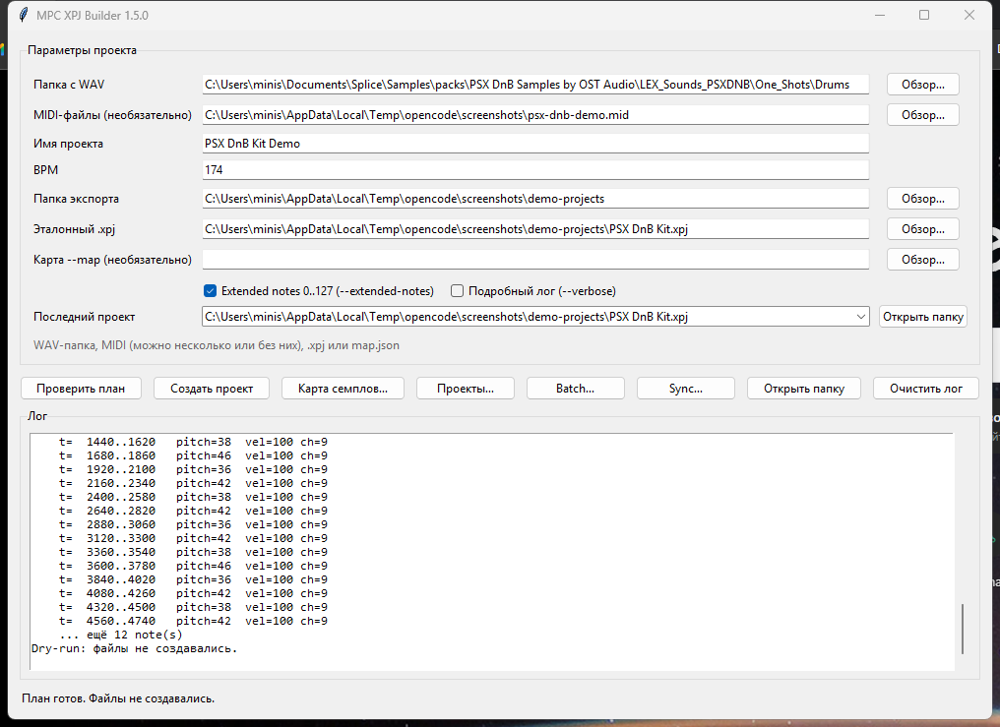
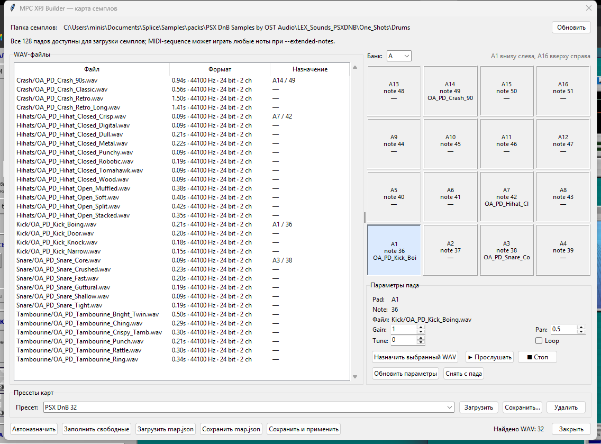
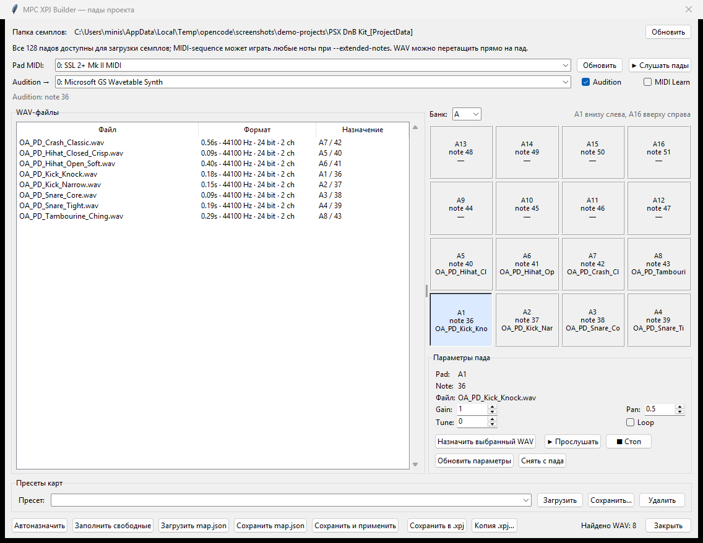
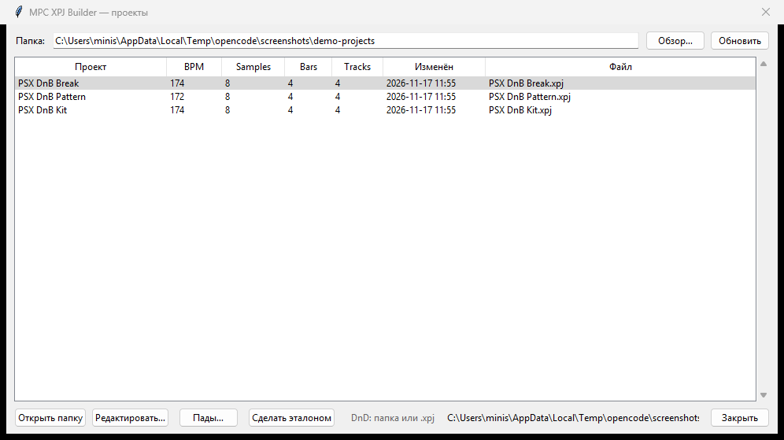
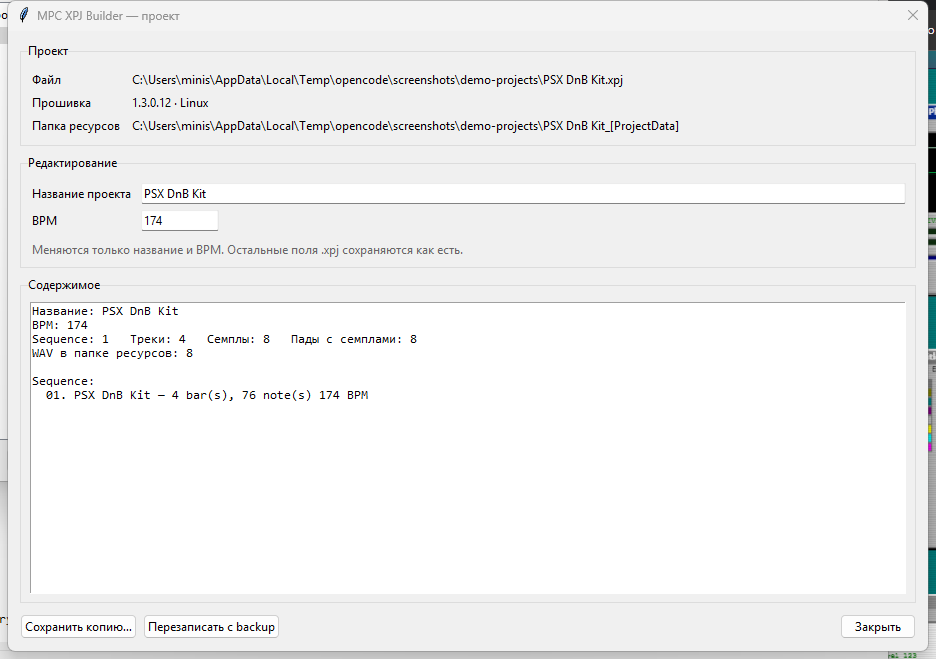
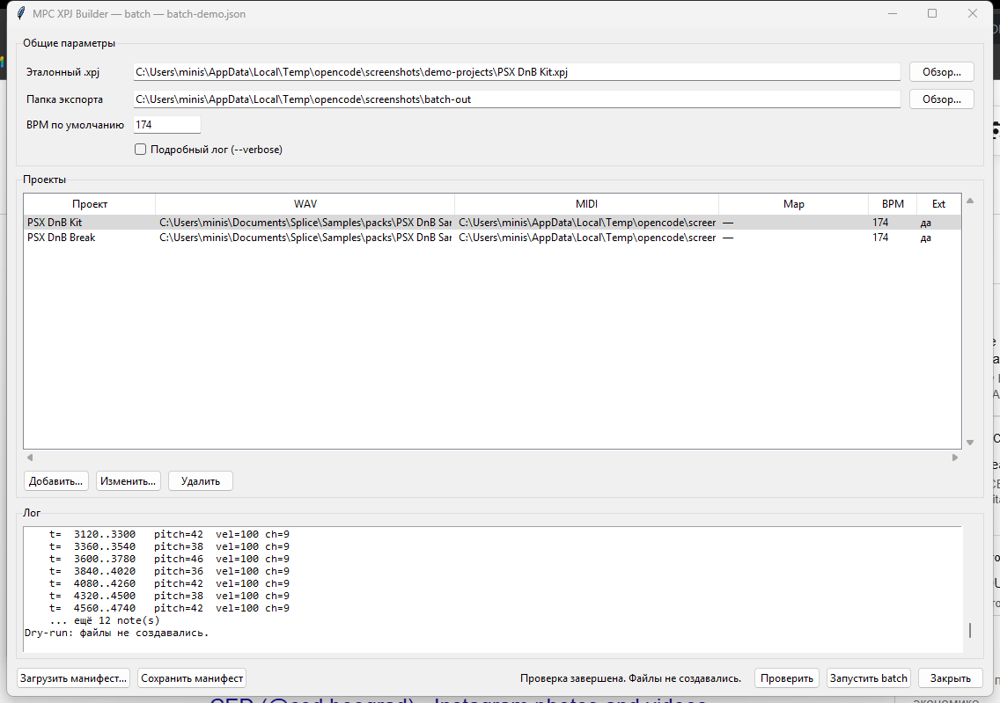
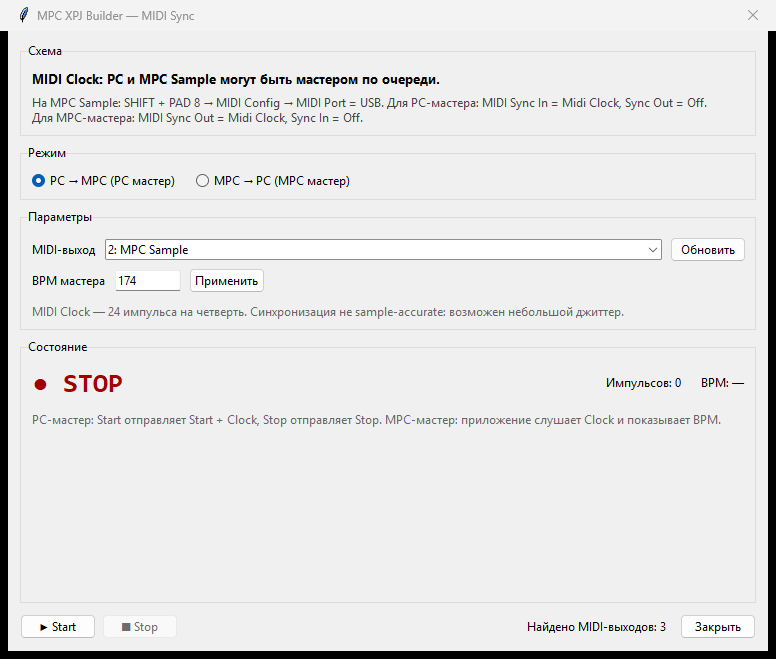
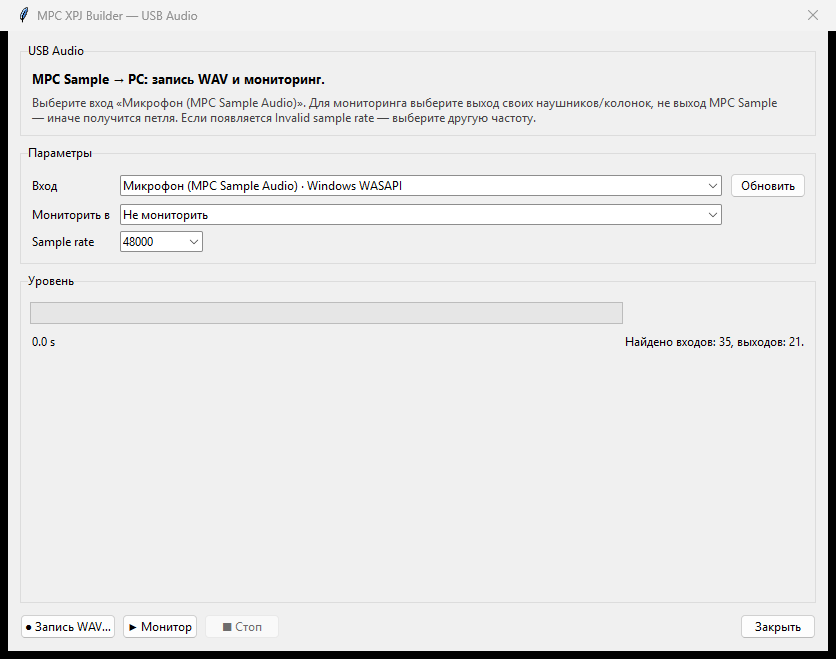

# Руководство пользователя

**mpc-xpj-builder 1.9.0** — сборка проектов `.xpj` для **Akai MPC Sample** из
папки WAV и одного Standard MIDI File.

Инструмент не пишет формат `.xpj` с нуля: он клонирует эталонный проект,
созданный на вашей MPC, и заменяет только проверенные поля — имя, BPM, семплы,
назначения падов, sequence и ноты.

---

## 1. Установка

### Вариант A. Установщик

1. Скачайте `mpc-xpj-builder-v1.9.0-setup.exe` со страницы
   [Releases](https://github.com/cursednik/mpc-xpj-builder/releases).
2. Запустите установщик.
3. Windows может показать предупреждение SmartScreen, потому что установщик не
   подписан. Нажмите **«Подробнее» → «Выполнить в любом случае»**.
4. После установки в меню «Пуск» появятся:
   - **MPC XPJ Builder** — графический интерфейс;
   - **MPC XPJ Builder CLI** — консольная версия.

### Вариант B. Портативная версия

1. Скачайте `mpc-xpj-builder-v1.9.0-win64.zip`.
2. Распакуйте архив в любую папку.
3. Запустите `mpc-xpj-builder-gui.exe`.

Python и другие зависимости не нужны.

### Вариант C. Из исходников

Нужен Python 3.11+.

```powershell
python -m venv .venv
.\.venv\Scripts\Activate.ps1
python -m pip install -e .
mpc-xpj-builder-gui
```

---

## 2. Быстрый старт в GUI



1. **Эталонный `.xpj`** — укажите проект, сохранённый на вашей MPC Sample.
   Это обязательное поле для реального экспорта.
2. **Папка с WAV** — папка с одним или несколькими семплами.
3. **MIDI-файл(ы)** — необязательно. Один или несколько `.mid` / `.midi`; каждый
   станет отдельной sequence. Если MIDI не указан, проект создаётся с одной
   пустой sequence на 1 такт.
4. **Имя проекта** — имя будущего `.xpj`.
5. **BPM** — темп проекта.
6. **Папка экспорта** — куда записать результат.
7. Нажмите **«Проверить план»**. Файлы не создаются, но вы увидите, какие
   семплы и ноты будут использованы.
8. Нажмите **«Создать проект»**.

Результат:

```text
PSX DnB Kit.xpj
PSX DnB Kit_[ProjectData]\
    Kick.wav
    Snare.wav
    ...
```

Скопируйте `.xpj` и папку `_[ProjectData]` на MPC Sample, сохранив их рядом.

### Поля главного окна

| Поле | Назначение |
| --- | --- |
| Папка с WAV | Откуда брать семплы. Подпапки сканируются. |
| MIDI-файл(ы) | Необязательно. Один или несколько `.mid`; каждый становится sequence. |
| Имя проекта | Имя `.xpj` и папки ресурсов. |
| BPM | Темп sequence. |
| Папка экспорта | Куда писать проект. |
| Эталонный `.xpj` | Шаблон схемы. Обязателен для экспорта. |
| Карта `--map` | Необязательный JSON с точными назначениями. |
| Extended notes | Разрешает MIDI-ноты 0–127 и банки B–H. |
| Подробный лог | Показывает каждый обработанный WAV. |

### Последний проект

GUI запоминает до 10 созданных проектов. Выберите проект в списке
**«Последний проект»** и нажмите **«Открыть папку»**, чтобы перейти к нему в
проводнике.

---

## 3. Редактор карты семплов



Кнопка **«Карта семплов…»** открывает редактор.

Слева — все WAV в выбранной папке с длительностью, частотой, каналами и
разрядностью. Справа — сетка падов текущего банка A–H и параметры выбранного
пада. Сетка ориентирована как на физическом MPC Sample: **A1 внизу слева**,
**A16 вверху справа**.

### Что можно делать

- **Назначить вручную** — выберите WAV, выберите пад, нажмите
  **«Назначить выбранный WAV»** (или дважды щёлкните по WAV).
- **Автоназначить** — раскладывает семплы по именам: `kick`, `snare`, `hat`,
  `ride`, `crash`, `tom`, `perc`, `clap`, `rim`, `shaker` и т.п.
- **Заполнить свободные** — занимает оставшиеся пады оставшимися WAV.
- **Параметры пада** — `Gain` (0–1), `Pan` (0–1), `Tune` (−24…+24 полутонов),
  `Loop`.
- **Снять с пада** — убирает назначение.
- **Сохранить `map.json`** — записывает карту на диск.
- **▶ Прослушать** — проигрывает выбранный WAV из списка. Если WAV не выбран,
  проигрывается семпл, назначенный на выбранный пад. **■ Стоп** останавливает
  воспроизведение. Preview играет исходный WAV без gain/pan/tune/loop.
- **Автовоспроизведение** — при клике по WAV в списке файл сразу проигрывается,
  без нажатия кнопки.
- **Сохранить и применить** — записывает карту и подставляет её путь в главное
  окно.

Блок **«Пресеты карт»** позволяет хранить именованные карты отдельно от рабочих
файлов:

- **Сохранить…** — записать текущие назначения под именем пресета;
- **Загрузить** — вернуть назначения из пресета в редактор;
- **Удалить** — удалить выбранный пресет.

Пресеты лежат в:

```text
%APPDATA%\mpc-xpj-builder\map-presets\
```

Пресет не подставляется в `--map` автоматически: после загрузки нажмите
**«Сохранить и применить»**, чтобы получить обычный `map.json` и передать его в
главное окно.

Кнопка **«Обновить»** перечитывает папку, если вы добавили или удалили WAV.

### Формат `map.json`

```json
{
  "samples": [
    {
      "file": "kicks/kick.wav",
      "note": 36,
      "gain": 0.9,
      "pan": 0.5,
      "tune": 0.0,
      "loop": false
    },
    {
      "file": "snares/snare.wav",
      "pad": "B1",
      "gain": 1.0
    }
  ]
}
```

- `file` — путь относительно папки с WAV;
- `note` — MIDI-нота (35–51, с extended notes 0–127);
- `pad` — `A1`…`H16`, альтернатива `note`;
- один WAV можно назначить на несколько падов;
- WAV, которых нет в карте, игнорируются;
- дубли `note`/`pad` запрещены.

---

### Пады существующего проекта

В **«Проекты…»** выберите проект и нажмите **«Пады…»**.



Редактор работает с папкой `_[ProjectData]` проекта:

- показывает текущие назначения падов из `.xpj`;
- позволяет назначать WAV из папки ресурсов, снимать назначение;
- редактирует `gain`, `pan`, `tune`, `loop`;
- поддерживает автоназначение и пресеты карт;
- **«Сохранить в .xpj»** пишет изменения с backup `<имя>.xpj.bak`;
- **«Копия .xpj…»** создаёт новый проект и копирует ресурсы.

Можно менять только пады и их параметры. Новые WAV в существующий `.xpj` пока
не добавляются: файл должен уже входить в samples проекта.

Изменения не отправляются на MPC в реальном времени. После сохранения
перезагрузите проект на устройстве.

### Живой Pad MIDI

1. На MPC: `Pad MIDI Out = Always`, `MIDI Port = USB`.
2. В редакторе падов выберите MIDI-вход `MPC Sample`.
3. Нажмите **▶ Слушать пады**.
4. Нажимайте пады на MPC — приложение подсветит пад и покажет note/velocity.

Это монитор нажатий. Он не меняет назначения на MPC.

### Audition и MIDI Learn

- **Audition** — клик по паду в приложении отправляет ноту на MPC. Нужен
  MIDI-выход `MPC Sample` и на MPC `Pad MIDI In = On`. Галочку `Audition`
  можно отключить.
- **MIDI Learn** — выберите WAV, включите `MIDI Learn`, нажмите пад на MPC.
  WAV назначится на пад с текущими `gain`/`pan`/`tune`/`loop`. После этого
  сохраните проект в `.xpj`.

Изменения назначений не уходят на MPC в реальном времени: сохраните `.xpj` и
перезагрузите проект на устройстве.

## 4. Браузер проектов



Кнопка **«Проекты…»** показывает все `.xpj` в папке экспорта: имя, BPM, число
семплов, такты, число треков и дату изменения.

- **«Открыть папку»** — открывает папку выбранного проекта.
- **«Редактировать…»** — название и BPM проекта.
- **«Пады…»** — редактор назначений и параметров падов.
- **«Сделать эталоном»** — подставляет выбранный `.xpj` в поле
  **«Эталонный `.xpj`»**.

В окно браузера можно перетащить папку с проектами или `.xpj`. Папка
открывается, а перетащенный проект автоматически выбирается в таблице.

### Редактирование существующего проекта

Выберите проект и нажмите **«Редактировать…»**. Откроется окно с информацией:



- файл, прошивка и platform;
- название, BPM и список sequence;
- число треков, семплов, падов с семплами;
- папка `_[ProjectData]` и число WAV в ней.

Менять можно **название проекта** и **BPM**. Остальные поля `.xpj`
сохраняются как есть, включая неизвестные поля.

Два режима сохранения:

- **«Сохранить копию…»** — создаёт новый `.xpj` и копирует папку ресурсов.
  Исходный проект не меняется.
- **«Перезаписать с backup»** — атомарно перезаписывает исходный `.xpj`,
  предварительно создавая `<имя>.xpj.bak`.

Важно: это файловый обмен, а не совместное редактирование. Не редактируйте
один и тот же проект одновременно на MPC и на PC — изменения могут
перезаписать друг друга.

Пады редактируются через кнопку **«Пады…»** (см. раздел 3). В этом окне
меняются только название и BPM.

Это удобно, когда нужно быстро переключаться между разными эталонами прошивки.

---

## 5. Drag-and-drop

В главное окно можно перетащить объект из проводника:

| Объект | Куда попадёт |
| --- | --- |
| Папка с WAV | «Папка с WAV» |
| Один `.wav` | его родительская папка |
| `.mid` / `.midi` | «MIDI-файл» |
| `.xpj` | «Эталонный `.xpj`» |
| `.json` | «Карта `--map`» |

Если перетащить несколько объектов разных типов одновременно, каждый попадёт в
своё поле. Статус внизу окна покажет, что было принято.

Несколько MIDI-файлов можно перетащить одновременно: они будут перечислены в
поле MIDI через `;`, и каждый станет отдельной sequence.

В окно **«Проекты…»** можно перетащить папку или `.xpj` (см. раздел 4).

---

## 6. Batch-режим

Batch нужен, чтобы собрать несколько проектов одним запуском.

### Batch в GUI

Кнопка **«Batch…»** открывает отдельное окно:



- общие поля: эталонный `.xpj`, папка экспорта, BPM по умолчанию;
- таблица проектов: имя, WAV, MIDI, карта, BPM, extended notes;
- **«Добавить…»** / **«Изменить…»** / **«Удалить»** — редактирование списка;
- **«Загрузить манифест…»** — открыть существующий JSON;
- **«Сохранить манифест»** — проверить и записать JSON;
- **«Проверить»** — dry-run всего batch;
- **«Запустить batch»** — создать все проекты.

Перед запуском манифест сохраняется автоматически. Если путь ещё не задан,
GUI предложит выбрать файл. Ошибка в одном job блокирует весь batch до записи
файлов.

### Манифест вручную

Создайте JSON-манифест:

```json
{
  "template": "D:\\MPC-Sample\\Projects\\reference.xpj",
  "output": "D:\\MPC-Sample\\Projects",
  "bpm": 174,
  "jobs": [
    {
      "name": "Kit A",
      "samples": "C:\\Samples\\Kit A",
      "midi": "C:\\MIDI\\kit-a.mid",
      "map": "C:\\Samples\\Kit A\\map.json"
    },
    {
      "name": "Kit B",
      "samples": "C:\\Samples\\Kit B",
      "midi": [
        "C:\\MIDI\\kit-b-verse.mid",
        "C:\\MIDI\\kit-b-chorus.mid"
      ],
      "bpm": 160
    }
  ]
}
```

Проверка без записи:

```powershell
mpc-xpj-builder --batch "C:\MPC Projects\batch.json" --dry-run
```

Экспорт:

```powershell
mpc-xpj-builder --batch "C:\MPC Projects\batch.json" --verbose
```

Правила:

- относительные пути считаются от папки манифеста;
- `template`, `output`, `bpm` можно задать глобально и переопределить в job;
- `map` и `extended_notes` задаются на уровне job;
- `midi` необязателен: без него job создаёт kit с пустой sequence;
- сначала проверяются все job; при ошибке не создаётся ни один проект;
- дубли имён и путей запрещены.

---

## 7. CLI без GUI

Проверить эталон:

```powershell
mpc-xpj-builder --inspect reference.xpj
```

План без записи:

```powershell
mpc-xpj-builder `
  --samples "C:\Samples\Kit" `
  --midi "C:\MIDI\drums.mid" `
  --name "My Kit" `
  --bpm 174 `
  --output "C:\MPC Projects" `
  --dry-run --verbose
```

Экспорт:

```powershell
mpc-xpj-builder `
  --samples "C:\Samples\Kit" `
  --midi "C:\MIDI\drums.mid" `
  --name "My Kit" `
  --bpm 174 `
  --output "C:\MPC Projects" `
  --template "C:\MPC Projects\reference.xpj" `
  --verbose
```

Несколько MIDI-файлов — несколько sequence:

```powershell
mpc-xpj-builder `
  --samples "C:\Samples\Kit" `
  --midi "C:\MIDI\verse.mid" `
  --midi "C:\MIDI\chorus.mid" `
  --name "My Kit" `
  --bpm 174 `
  --output "C:\MPC Projects" `
  --template "C:\MPC Projects\reference.xpj" `
  --verbose
```

Те же файлы можно передать одной строкой через `;`:

```powershell
mpc-xpj-builder --midi "C:\MIDI\verse.mid;C:\MIDI\chorus.mid" ...
```

Без MIDI — только kit с пустой sequence:

```powershell
mpc-xpj-builder `
  --samples "C:\Samples\Kit" `
  --name "My Kit" `
  --bpm 120 `
  --output "C:\MPC Projects" `
  --template "C:\MPC Projects\reference.xpj" `
  --verbose
```

С картой и extended notes:

```powershell
mpc-xpj-builder `
  --samples "C:\Samples\Kit" `
  --midi "C:\MIDI\drums.mid" `
  --name "My Kit" `
  --bpm 174 `
  --output "C:\MPC Projects" `
  --template "C:\MPC Projects\reference.xpj" `
  --map "C:\MPC Projects\kit-map.json" `
  --extended-notes `
  --verbose
```

Полный список параметров:

```powershell
mpc-xpj-builder --help
```

### Коды возврата

| Код | Значение |
| ---: | --- |
| 0 | успех / dry-run |
| 2 | ошибка аргументов CLI |
| 3 | ошибка валидации входных данных |
| 4 | нужен эталонный `.xpj` |
| 5 | ошибка файловой системы / записи |
| 1 | непредвиденная ошибка |

---

## 8. Синхронизация с MPC Sample



Кнопка **«Sync…»** в главном окне умеет работать в двух режимах:

- **PC → MPC** — PC отправляет MIDI Clock, Start и Stop;
- **MPC → PC** — приложение слушает MIDI Clock от MPC.

### PC — мастер

1. Подключите MPC Sample к PC по USB-C.
2. На MPC нажмите **SHIFT + PAD 8**, чтобы открыть **MIDI Config**.
3. Установите:
   - **MIDI Port** = `USB`;
   - **MIDI Sync In** = `Midi Clock`;
   - **MIDI Sync Out** = `Off`.
4. В окне **Sync…** выберите режим **PC → MPC**.
5. Выберите MIDI-выход `MPC Sample`, укажите BPM и нажмите **▶ Start**.
6. **■ Stop** останавливает транспорт.

BPM можно менять на лету кнопкой **«Применить»**.

### MPC — мастер

1. На MPC установите:
   - **MIDI Sync Out** = `Midi Clock`;
   - **MIDI Sync In** = `Off`.
2. В окне **Sync…** выберите режим **MPC → PC**.
3. Выберите MIDI-вход `MPC Sample` и нажмите **▶ Слушать**.
4. Запустите транспорт на MPC.

Приложение будет показывать входящий BPM, состояние PLAY/WAIT и число
принятых импульсов.

### Что происходит

- MIDI Clock — 24 импульса на четверть.
- В режиме PC-мастера Start запускает MPC, Stop останавливает.
- В режиме MPC-мастера приложение только слушает и показывает темп.
- Синхронизация не sample-accurate: возможен небольшой джиттер.
- MIDI Clock синхронизирует темп и транспорт, но не компенсирует аудиозадержку.

### Если MPC Sample не виден

- Проверьте USB-кабель: нужен data-кабель, не только зарядный.
- Проверьте `MIDI Port = USB` на MPC.
- Закройте другие приложения, которые могли занять MIDI-порт.
- Нажмите **«Обновить»** в окне Sync.
- Для режима MPC-мастера проверьте, что на MPC включён `MIDI Sync Out`. 

## 9. USB Audio



Кнопка **«Audio…»** в главном окне открывает запись и мониторинг USB-аудио
MPC Sample.

### Запись

1. Подключите MPC Sample по USB-C.
2. Откройте **«Audio…»**.
3. Вход: **«Микрофон (MPC Sample Audio)»**.
4. Нажмите **● Запись WAV…** и выберите файл.
5. **■ Стоп** завершает запись.

Результат — стерео WAV, int16 PCM.

### Мониторинг

1. Вход: **«Микрофон (MPC Sample Audio)»**.
2. **Мониторить в**: выход наушников или колонок.
3. Нажмите **▶ Монитор**.

Не выбирайте выход MPC Sample для мониторинга его же входа — получится петля.

### Sample rate

На тестовой машине MPC Sample работал на **48000 Hz**. Если при запуске
появляется `Invalid sample rate`, выберите другую частоту.

### Ограничения

- Один стереопоток; многодорожечной записи нет.
- Нет ASIO и компенсации задержки.
- WDM-KS-устройства исключены: они не поддерживают blocking API PortAudio.
- Используется PortAudio (`sounddevice`). В installer/portable ZIP он уже
  включён; при запуске из исходников установите `pip install -e ".[audio]"`.

## 10. Настройки

GUI сохраняет последние пути и флаги в:

```text
%APPDATA%\mpc-xpj-builder\settings.json
```

Удалите этот файл, если хотите сбросить настройки.

---

## 11. Решение проблем

### «Требуется эталонный .xpj от MPC Sample для заполнения схемы»

Экспорт без эталона заблокирован намеренно. Создайте минимальный drum-проект на
MPC Sample, скопируйте `.xpj` на компьютер и укажите его в поле
**«Эталонный `.xpj`»**. Эталон должен быть создан **той же прошивкой**, на
которой будет открываться результат.

### «Файл уже существует»

Проект с таким именем уже есть в папке экспорта. Измените имя проекта или
удалите/переместите старый файл. `--dry-run` тоже проверяет это.

### Семплы не попали в проект

- Проверьте, что это именно WAV (RIFF/WAVE, PCM или float).
- Максимум — 128 WAV.
- Если указана карта `--map`, используются только файлы из неё.
- WAV с неподдерживаемым форматом пропускаются; подробности включает
  `--verbose`.

### Пад не звучит

- По умолчанию поддерживаются ноты 35–51.
- Для нот вне этого диапазона включите **Extended notes** или
  `--extended-notes`.
- Проверьте, что нота в MIDI действительно попадает на назначенный пад.

### Loop не играет

Loop задаётся в редакторе карты флажком **Loop** или полем `"loop": true` в
`map.json`. В `.xpj` это включает `triggerMode = 3` у инструмента.

### Drag-and-drop не срабатывает

- Перетаскивайте объект именно в окно приложения.
- Если окно запущено от администратора, а проводник — нет (или наоборот),
  Windows может блокировать drop. Запустите оба от одного пользователя.
- Проверьте версию: DnD исправлен начиная с v0.10.2.

### SmartScreen предупреждает об установщике

Установщик не подписан сертификатом. Это ожидаемо для open-source сборки.
Сверьте SHA-256 с указанным на странице релиза.

---

## 12. Известные ограничения

- Формат `.xpj` закрытый. Инструмент клонирует эталон и не синтезирует
  неизвестные поля.
- Один MIDI-файл превращается в одну sequence; несколько файлов создают
  несколько sequence в одном проекте.
- Без MIDI создаётся пустая sequence на 1 такт — паттерн нужно записать
  на самом MPC Sample.
- Максимум 128 семплов на проект.
- Папка ресурсов всегда называется `<Имя>_[ProjectData]`.
- Hardsynth-инструменты, эффекты и микшер берутся из эталона без изменений.
- USB Audio: один стереопоток, без ASIO и компенсации задержки.
- Пады существующего проекта: только WAV, уже входящие в `samples`;
  изменения не отправляются на MPC в реальном времени.
- MIDI Sync не sample-accurate: возможен джиттер; аудиосинхронизация и
  компенсация задержки пока не реализованы.
- Редактор существующего `.xpj` меняет только название и BPM; пады, семплы и
  паттерны редактируются через карту и повторную сборку.
- Preview WAV использует Windows MCI/winsound: редкие WAV с нестандартным
  кодеком могут не проигрываться в окне, хотя экспорт проходит проверку.
- Тестирование проводилось на MPC Sample с прошивкой 1.3.0.12 и Windows 11.

---

## 13. Проверка версии

```powershell
mpc-xpj-builder --version
```

В заголовке GUI также отображается версия.
